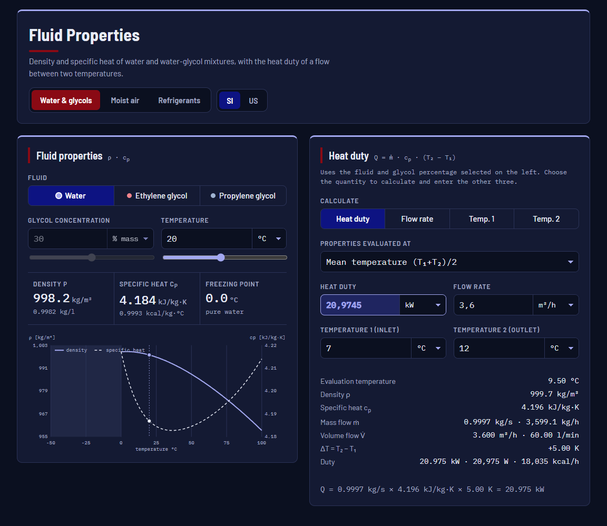

# Fluid Properties

A free, offline calculator for the thermophysical properties of the most common HVAC&R fluids. It is a single HTML file that runs in any modern browser, with no installation, no server and no internet connection needed.

**▶ Live tool:** https://giovagalo.github.io/fluid-properties/

## Features

### SI and US units
- One switch at the top of the page converts all inputs and results between **SI** and **US (IP)** units
- Temperatures in °C, °F or K, selectable next to each temperature field
- Flow and duty menus list the units of both systems
- The chosen units and concentration basis are remembered by the browser
- Add `?units=us` to the link to open the tool directly in US units

### Water & glycols
- Water, ethylene glycol and propylene glycol
- Glycol concentration **by mass (0–60 %) or by volume (10–60 %)**, with the equivalent concentration in the other basis shown
- Density, specific heat and freezing point
- Heat duty calculator, Q = ṁ · cp · (T₂ − T₁), solving for **heat duty, flow rate, T₁ or T₂**
- Flow in m³/h, l/min, l/s, US gpm, kg/s, kg/h, lb/h
- Duty in kW, W, kcal/h, tons of refrigeration, Btu/h, MBH
- Properties evaluated at mean temperature, T₁ or T₂

### Moist air
- Dry bulb plus one of wet bulb, relative humidity or humidity ratio
- Pressure entered directly or computed from altitude (kPa and m, or psia and ft)
- Wet bulb, dew/frost point, RH, humidity ratio, degree of saturation, enthalpy, specific volume, density, vapour pressures, cp
- Humidity ratio in g/kg or grains/lb; in US units enthalpy uses the ASHRAE IP reference (dry air at 0 °F)
- Interactive psychrometric chart

### Refrigerants
- 13 fluids: R32, R134a, R410A, R407C, R404A, R1234yf, R1234ze(E), R454B, R513A, R744, R290, R717, R600a
- Saturation from T or p (bubble / dew / mean temperature and glide for blends)
- Subcooled liquid, superheated vapour, supercritical (R744)
- Two-phase states from pressure and quality
- p-h diagram with the state point
- Pressure units: bar a, bar g, kPa a, MPa a, psig, psia
- GWP₁₀₀ (IPCC AR4) and safety class (ISO 817 / ASHRAE 34) for each refrigerant

## Methods and accuracy

| Section | Method | Validity |
|---|---|---|
| Water | Density: Kell (1975); cp: polynomial fitted to IAPWS-95 | 0–100 °C |
| Glycols by mass | Melinder (2010) polynomials, coefficients from CoolProp (MEG, MPG) | 0–60 %, freezing point to 100 °C |
| Glycols by volume | ASHRAE Fundamentals (2001) data as fitted by SecCool, coefficients from CoolProp (AEG, APG) | 10–60 %, −35 °C (or freezing point) to 100 °C |
| Moist air | ASHRAE Handbook – Fundamentals (2017), Ch. 1, ideal-gas model with Hyland-Wexler saturation pressure | standard HVAC range |
| Refrigerants | Tables generated with CoolProp (HEOS) and cubic Lagrange interpolation | −60 °C to ~160 °C, p ≤ 0.99·pc |

Refrigerant accuracy against CoolProp (820 test points below 0.9·pc): Tsat < 0.001 K, h < 0.06 kJ/kg, density < 0.03 %, cp < 0.4 %. Enthalpy and entropy use the IIR reference state (h = 200 kJ/kg, s = 1 kJ/kg·K for saturated liquid at 0 °C). In US units this becomes h = 85.98 Btu/lb at 32 °F; many US tables use the ASHRAE reference (h = 0 at −40 °F), so absolute enthalpies differ but enthalpy differences are the same.

**Mass vs volume concentration.** The volume basis is not converted to mass: as in CoolProp, a separate data set written directly in volume fraction is used. For the same mixture, the ASHRAE density is 0.2–0.9 % higher than Melinder's, and cp differs by up to about ±1.8 % for ethylene glycol (within 0.2 % for propylene glycol). The equivalent concentration comes from the ASHRAE volume–mass table (e.g. 30 % by mass ≈ 27.7 % by volume of ethylene glycol).

**Units.** All calculations are performed in SI units; US inputs and results are converted with standard factors (1 Btu/lb·°F = 4.1868 kJ/kg·K, 1 lb/ft³ = 16.0185 kg/m³, 1 US gpm = 3.78541 l/min, 1 ton = 12 000 Btu/h = 3.51685 kW).

## Usage

Open the live link above, or download `index.html` and open it in your browser. It works fully offline.

## Disclaimer

This tool is intended for preliminary engineering calculations. Results are provided without warranty; verify critical values against a reference source before using them for design.

## About

Built with the help of AI (Claude by Anthropic). The engineering choices, references and validation were mine.

## Credits

- [CoolProp](http://www.coolprop.org/), Bell et al. (2014), *Ind. Eng. Chem. Res.* 53(6), 2498–2508 (MIT licence)
- Melinder, Å. (2010), *Properties of Secondary Working Fluids for Indirect Systems*, IIR
- Kell, G. S. (1975), *J. Chem. Eng. Data* 20(1), 97–105
- ASHRAE Handbook – Fundamentals (2017; 2001 for glycol solutions by volume)
- Skovrup, M. J. (2013), SecCool software, IPU / DTU

## License

© 2026 Giovanni Galoppi
